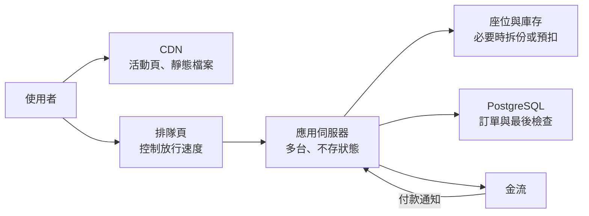

之前那篇[資料庫規劃筆記](/posts/database-planning-interview-notes/)談的是最後一張票怎麼不賣兩次。那只是資料庫裡的一小段。如果開賣當下湧進幾萬人，網頁打不開、API 逾時、資料庫連線用完，問題就不只在一句 SQL 了。

「設計一個能讓很多人同時使用的系統」常出現在系統設計的討論裡。查了一些資料、想了幾個情境之後，我覺得這題沒有標準答案。同樣叫「很多人」，新聞網站、搶票和聊天室要處理的事情差很多，團隊大小和預算也會改變選擇。

這篇把我目前的想法整理出來討論：遇到這種題目，我會先問哪些問題，常見做法各解決什麼，又會帶來哪些新的麻煩。文中的數字都是假設，換一個情境，結論可能就不一樣。

## 先問清楚：「很多人」是多少？

「很多人同時使用」可以指幾種不同的數字：

- 同時在線：開著網頁的人，不一定正在送請求。
- 每秒請求數：系統每秒要處理幾個請求，常寫成 RPS 或 QPS。
- 同時處理中的請求：已經進來、還沒回應的請求有幾個。

後兩者之間有個關係叫 [Little's Law](https://en.wikipedia.org/wiki/Little%27s_law)：長期平均來看，同時處理中的請求數 = 每秒進來的請求數 × 每個請求平均花的時間。每秒 500 個請求、平均 0.2 秒回應，平均大約有 100 個請求同時在處理。

這個式子提醒我，回應變慢，同時處理中的請求就會變多。假設資料庫變慢，回應時間從 0.2 秒拉長到 2 秒，同樣的流量下，卡在系統裡的請求會變成約 10 倍，連線池或記憶體就可能先用完。所以系統撐不住，不一定是人變多，也可能是某個環節變慢了。

只看平均流量也不夠。報名網站平常每秒只有幾個請求，開放報名的第一分鐘可能暴增好幾百倍。設計時要看的是尖峰有多高、會持續多久。

## 同樣是很多人，要處理的事情不一樣

除了數字，還要知道請求在做什麼。我把幾種情境排在一起比較：

| 情境           | 流量的樣子                     | 比較麻煩的地方                     |
| -------------- | ------------------------------ | ---------------------------------- |
| 新聞、部落格   | 讀多寫少，熱門文章被大量重複讀 | 快取多久、內容更新後多快要看到     |
| 搶票、限量商品 | 短時間尖峰，大家搶同一批庫存   | 不能超賣，沒搶到的人也要知道結果   |
| 聊天室         | 連線維持很久，訊息要即時推送   | 大量長連線、訊息順序與離線補送     |
| 公司內部報表   | 人不多，但單次查詢很重         | 大查詢拖慢資料庫，連帶影響其他功能 |

新聞網站的瓶頸常在讀取，搶票卡在同一筆庫存的寫入，聊天室則要管長連線。拿搶票的解法去做新聞網站，可能多了一堆用不到的元件。這篇主要談一般的網頁請求，長連線先不展開。

接著要問，資料能不能晚一點才正確：

- 金額、庫存、座位：寫錯了要退款或道歉，通常要在寫入當下就確認。
- 按讚數、瀏覽次數、推薦列表：晚幾秒才更新，多數使用者不會發現。

允許延遲的資料，才有空間放進快取或批次寫入。不能錯的資料也能交給背景處理，但延後的是回覆結果的時間，寫入時一樣要當場檢查，後面搶票用的佇列就是這樣。

最後是限制條件：團隊有幾個人、故障時誰來處理、預算多少、上線時間多趕，以及現在已經在用什麼。三個人的團隊多維運一套訊息佇列，付出的心力可能比多買一台大一點的機器還多。

## 先量測，再決定要改哪裡

k6、JMeter、Locust 這類壓力測試工具可以模擬大量請求。測的時候我會看：

- 回應時間的 p95、p99：p95 指 95% 的請求都在這個時間內完成，剩下 5% 更慢。平均值會把少數很慢的請求藏起來，[Google SRE 書談 SLO 的章節](https://sre.google/sre-book/service-level-objectives/)也建議用百分位數看整體分布。
- 錯誤率，以及流量加到多少開始出錯。
- 資料庫的 CPU、連線數、鎖等待和慢查詢。

測試資料和流量模式要接近真實。資料表只有一百筆時，少了索引也看不出來；所有測試請求都打同一個商品，快取命中率也會比實際高。

我會先排除便宜的問題：缺少索引、一個頁面跑了幾十次 SQL（先查出列表，再對每一筆各查一次，也就是 N+1 查詢）、把整張大圖傳給手機。這些修好，往往就能多撐不少流量，而且不用改架構。[資料庫規劃筆記](/posts/database-planning-interview-notes/)裡用過的 `EXPLAIN (ANALYZE, BUFFERS)`，可以看某一句查詢慢在哪；要先找出哪些查詢最耗時，可以看 `pg_stat_statements` 的統計，見 [PostgreSQL 的 pg_stat_statements 說明](https://www.postgresql.org/docs/current/pgstatstatements.html)，或開慢查詢日誌（`log_min_duration_statement`）。

## 讀取很多時：快取與讀取副本

讀多寫少的情境，最直接的做法是讓重複的讀取別每次都進資料庫。

公開、每個人看到都一樣的內容，例如活動頁、圖片和 JS 檔，可以交給 CDN。CDN 節點會依快取規則保存一份，大部分請求不必回到原始伺服器，可以參考 [CDN 與 Edge Computing](/posts/cdn-edge-computing/)。

需要經過程式組合的資料，可以放進 Redis 這類記憶體快取。常見的寫法是 cache-aside：先查快取，沒有再查資料庫，查到後寫回快取並設定到期時間。

快取換到的是速度，代價是可能讀到舊資料。我會先決定每種資料能舊多久：商品介紹晚五分鐘更新可以接受，剩餘票數就不能拿快取的數字當最後判斷，下單時還是要回資料庫確認。

補充：快取過期的那一刻，資料庫可能被打爆

熱門資料的快取剛好過期時，大量請求會同時發現快取沒有資料，一起去查資料庫，這種情況叫 [cache stampede](https://en.wikipedia.org/wiki/Cache_stampede)。中文資料常把單一熱門 key 過期叫「快取擊穿」，大量 key 同時過期或快取服務整個掛掉叫「快取雪崩」。

可以考慮的做法：

- 只讓一個請求去重建快取，其他請求等它完成，或先拿舊資料回應。
- 到期時間加一點隨機，避免大量 key 在同一刻過期。
- 快取快過期時就在背景更新。HTTP 快取也有類似的 `stale-while-revalidate`，允許內容過期後，在指定的秒數內先回舊內容、同時在背景重新驗證，見 [RFC 5861](https://www.rfc-editor.org/rfc/rfc5861.html)。

更新資料時，常見做法是先寫資料庫、再刪掉快取。不過讀取和更新剛好交錯時，舊值還是可能被寫回快取，所以到期時間仍要設，當作最後的保險。

快取之外，也可以加資料庫的讀取副本：主資料庫負責寫入，副本複製一份資料來分擔讀取。PostgreSQL 的串流複寫預設是非同步的，見 [PostgreSQL 的同步複寫說明](https://www.postgresql.org/docs/current/warm-standby.html#SYNCHRONOUS-REPLICATION)，所以副本的資料可能落後主資料庫一小段時間。

使用者剛改完暱稱，下一個請求被送到副本，就可能看到舊暱稱。剛寫入的資料可以先從主資料庫讀，或只把晚一點也沒關係的查詢送去副本。

## 寫入很多時：熱點、佇列與重複請求

讀取可以複製很多份，寫入就難了。搶票時大家改的是同一筆庫存，應用伺服器加得再多，最後還是排隊等那一筆資料的鎖。

資料庫規劃筆記用的條件式 `UPDATE` 能確保不超賣。量再大一點，可以考慮下面幾種做法，各有代價。

### 把庫存拆成幾份

1000 張票拆成 10 筆、每筆 100 張，請求隨機挑一筆扣，等待同一筆資料的請求就分散了。麻煩的是某幾筆扣完、別筆還有票時，請求得改試別筆；顯示剩餘張數也要把各筆加總。

### 先在 Redis 扣，再寫進資料庫

Redis 的單一指令會完整執行，不會被其他請求插進來，`DECR` 扣庫存就是這樣。不過 `DECR` 不檢查下限，庫存是 0 時一樣會扣成 -1，所以要看回傳值：小於 0 就當作沒搶到，再把那一張加回去。想把「還有票才扣」放在同一步，可以用 Lua script，它會整段執行完才處理下一個請求，見 [Redis 的 Lua script 說明](https://redis.io/docs/latest/develop/programmability/eval-intro/)。在 Redis 扣成功的請求，再去建立訂單。

代價是同一份庫存存在兩個地方。Redis 預設用非同步複寫，主節點故障、切換到副本時，可能遺失已經回應成功的寫入，見 [Redis 的複寫說明](https://redis.io/docs/latest/operate/oss_and_stack/management/replication/)。持久化如果用 AOF 搭配每秒同步到硬碟一次（`appendfsync everysec`），當機時也可能少掉約一秒的資料，見 [Redis 的持久化說明](https://redis.io/docs/latest/operate/oss_and_stack/management/persistence/)。所以資料庫仍要有自己的限制擋超賣，也要定期核對兩邊的數字。

### 把請求放進佇列，慢慢處理

尖峰時先把「我要買」的請求放進佇列，背景的 worker 用資料庫撐得住的速度處理，使用者先看到「處理中」。一瞬間的高峰，就被攤平到後面幾分鐘。

代價是結果不會馬上出來。前端要能查詢處理進度或等通知；佇列太長時，也要決定讓後面的人等多久，或直接告訴他們已經售完。

不少佇列服務保證的是「至少送達一次」（at-least-once），同一則訊息可能被處理兩次，[Amazon SQS 的標準佇列](https://docs.aws.amazon.com/AWSSimpleQueueService/latest/SQSDeveloperGuide/standard-queues.html)就是一例。worker 要能認出重複的工作。例如 API 收下請求時就先產生一個編號，放進訊息裡，也回給前端查進度用；worker 寫入時用這個編號加上唯一限制擋住。

重試也會帶來重複。使用者按了兩次、前端逾時後重送，同一筆購買都可能進來兩次。[API 請求卡住怎麼辦](/posts/api-resilience-patterns/)那篇提過 Idempotency Key，流量大的時候更需要它：尖峰時逾時變多，重送也跟著變多，同一筆購買處理兩次，可能多佔一張票或重複扣款。不過它只能擋住重複處理，重送的請求還是會進來佔用資源，所以重試也要退避、加一點隨機，別在系統最忙的時候一起重送。

## 服務本身怎麼擴展？

應用伺服器要能加台數（水平擴展），前提是它不把狀態存在自己身上。登入狀態、上傳到一半的檔案如果只存在某台機器的記憶體或硬碟，下一個請求被分到別台就找不到了。[The Twelve-Factor App](https://12factor.net/processes) 也建議程式本身不保存狀態，需要保存的放到資料庫這類外部服務。

應用伺服器變多，壓力會轉到資料庫。PostgreSQL 為每條連線開一個獨立的後端程序，見 [PostgreSQL 的連線建立方式](https://www.postgresql.org/docs/current/connect-estab.html)；`max_connections` 預設通常是 100，見 [PostgreSQL 的連線設定](https://www.postgresql.org/docs/current/runtime-config-connection.html)。10 台應用伺服器各開 20 條連線，就是 200 條，已經超過預設值。

這時可以在中間放 PgBouncer 這類連線池，讓很多應用程式連線共用較少的資料庫連線。用 transaction 模式時，有些需要固定在同一條連線上的功能要另外確認，見 [PgBouncer 的功能對照](https://www.pgbouncer.org/features.html)。

資料庫本身的擴展，常見的做法有這幾種，越往下改動越大：

1. 換一台規格更好的機器（垂直擴展）。最簡單，程式幾乎不用改，但有上限，費用也會越來越高。
2. 加讀取副本，分擔讀取。
3. 把大表依時間或範圍拆成分割表（partitioning）。查詢條件有帶到分割欄位時，只會讀到其中幾份，清理舊資料也能直接刪掉整張分割表，見 [PostgreSQL 的分割表說明](https://www.postgresql.org/docs/current/ddl-partitioning.html)。
4. 分片（sharding），把資料分散到多個資料庫。能分擔寫入，但跨分片的查詢、交易和搬移資料都會變難，分片的依據選得不好，還會讓某一片特別忙。

這幾步解決的問題不一樣：讀取副本只分擔讀取，分割表讓查詢和清理只碰其中一部分，分片才是把寫入分散到多台資料庫。所以我會先看瓶頸在哪，再挑對應的做法；能解決同一個問題時，越往下越難回頭，我會先選前面的。

## 撐不住的時候，先保住核心功能

設計得再好，流量還是可能超出預期。這時我希望系統先放掉不重要的事，讓核心流程繼續動：

- 限流：限制每個使用者或 IP 在一段時間內能送幾次請求。超過的回 `429 Too Many Requests`（[RFC 6585](https://www.rfc-editor.org/rfc/rfc6585.html#section-4)），可以加上 `Retry-After` 告訴對方多久後再試（[RFC 9110](https://www.rfc-editor.org/rfc/rfc9110.html#field.retry-after)）。
- 主動拒絕：伺服器已經很忙時，直接拒絕一部分新請求，讓已經接下的請求能準時完成。AWS 的[負載卸除文章](https://builder.aws.com/content/3Eun1EEyX6p2e3VYNyRLSJzLuMV/using-load-shedding-to-avoid-overload)說明了為什麼這比全部收下、全部變慢好。
- 降級：推薦列表、即時人數這類附加功能先關掉或改用快取內容，把資源留給下單和付款。
- Timeout 與斷路器：依賴的服務變慢時，別讓請求一直卡著，細節在 [API 請求卡住怎麼辦](/posts/api-resilience-patterns/)。

限流的基準也要選。用 IP 限制，同一間公司或學校共用對外 IP 的人可能一起被擋；用帳號限制，又擋不住大量註冊的機器人帳號。

## 用報名系統比較兩種情況

同樣是「活動報名」，條件一換，我的答案就會差很多。

### 社區活動：500 個名額

假設名額 500 個，開放報名時可能有幾百人同時在填表，團隊只有一兩個人。

我會用一台應用伺服器，加上一個託管的 PostgreSQL。名額用條件式 `UPDATE` 扣，Email 或手機號碼加上唯一限制避免重複報名，報名 API 再加上基本的限流。上線前用接近的資料量壓測一次，確認尖峰時的 p99 和錯誤率。

這樣的架構好理解、好除錯，壞了也知道去哪裡查。代價是只有一台應用伺服器，開放報名那幾分鐘剛好當掉就沒有備援；社區活動晚一點恢復通常還能接受，真的在意，也可以多開一台放在負載平衡器後面。

如果為了「以後可能變大」先拆成很多服務、加上佇列，多出來的維運工作可能比流量本身還麻煩。

### 演唱會售票：一萬張票，幾十萬人搶

假設票有一萬張，開賣後幾分鐘內湧入幾十萬人，還有人用機器人搶票。

資料庫的條件式更新仍然能保證不超賣，但擋不住幾十萬個請求先把前面的服務壓垮。這時我可能會考慮：

- 活動頁和靜態檔案放 CDN，並確認快取設定真的生效。
- 前面加排隊頁，依後端撐得住的速度放人進來，排隊的人看得到自己的順位。
- 放進來的人才能選位，選位後保留座位一段時間，逾時沒付款就釋放。付款成功和逾時釋放撞在一起的情況，[資料庫規劃筆記](/posts/database-planning-interview-notes/)有討論。
- 對號入座時，每個座位本來就是一筆資料，只有搶同一個座位的人會互相等，用條件式更新或唯一限制就能擋；不劃位或只選區域時，同一區的張數才會集中在一筆資料上。排隊頁已經限制了放行速度，要不要再拆成幾份或先在 Redis 扣，就看壓測時那筆資料的鎖等待還是不是瓶頸。資料庫的限制都留著，當作最後一道檢查。
- 限流、驗證碼等防機器人措施，以及開賣前用接近的流量完整壓測一次。

這張圖只是其中一種組合，每個方塊都有成本：排隊頁要處理公平性和插隊，Redis 預扣要核對數字，多台伺服器要有人監控。如果同時來搶的只有幾百人，這些幾乎都用不到；反過來，就算票只有五百張，只要湧進來幾十萬人，CDN、排隊頁和限流一樣省不掉。

## 我目前的思考順序

遇到這類題目，我現在大概會照這個順序想：

1. 問清楚尖峰流量、讀寫比例、哪些資料不能錯，以及團隊和預算的限制。
2. 量測，找出瓶頸在哪裡。
3. 先做便宜的改善：索引、減少多餘的查詢、把靜態檔案交給 CDN。
4. 讀取多，就加快取和讀取副本，並決定每種資料能舊多久。
5. 寫入搶同一份資料，就分散熱點，或用佇列攤平尖峰。
6. 準備限流、降級和逾時，讓系統超出負荷時還守得住核心功能。

每加一個元件，我會記下它解決了哪個問題，又讓什麼變得更難。討論這類題目時，我覺得說得出放棄了什麼，比列出一長串技術名詞有用。

實際要怎麼做，還是得看專案當下的需求、限制和量測結果。

## 站內相關文章

- [資料庫規劃筆記：從搶票、多對多關係到回歸測試](/posts/database-planning-interview-notes/)
- [PostgreSQL、MySQL、SQLite、SQL Server、MongoDB 怎麼選？從需求到語法的比較筆記](/posts/database-systems-comparison/)
- [API 請求卡住怎麼辦？Timeout、Retry 與 Circuit Breaker](/posts/api-resilience-patterns/)
- [從商品列表到建立訂單，API 要怎麼設計？](/posts/api-design-products-orders/)
- [CDN 與 Edge Computing：為什麼有些網站就是比較快？](/posts/cdn-edge-computing/)
