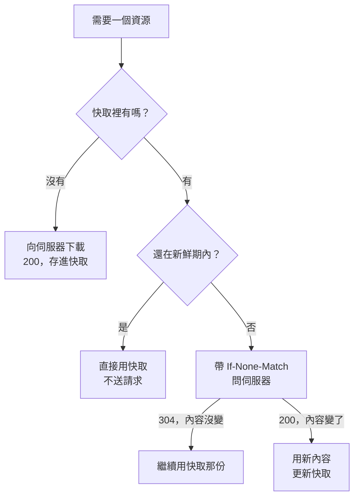

同一個網站，第二次打開通常比第一次快，因為瀏覽器把上次下載的檔案留了一份。但部署新版之後，偶爾有人回報「我這邊還是舊的」，原因往往也是同一份快取。

要讓快取該用的時候用、該換的時候換，靠的是伺服器回應裡的幾個標頭。這些規則定義在 [RFC 9111](https://www.rfc-editor.org/rfc/rfc9111.html)，我用這個部落格自己的設定當例子，整理一遍它是怎麼運作的。

## 快取存在哪些地方？

一個回應從伺服器到畫面，中間可能被存在兩種地方：

- 瀏覽器自己的快取，只給這一個使用者用，規範裡叫私有快取（private cache）。
- CDN 或代理伺服器的快取，很多使用者共用同一份，叫共用快取（shared cache）。[CDN 那篇](/posts/cdn-edge-computing/)講的邊緣節點就是這種。

兩者讀的是同一組標頭，只是有些指令只對其中一種有效。這篇主要從瀏覽器的角度看，遇到共用快取要注意的地方再另外說明。

## 新鮮期：max-age 還沒到，就直接用

快取裡的回應有「新鮮」和「過期」兩種狀態。伺服器用 `Cache-Control: max-age` 告訴快取，這份回應可以新鮮多久，單位是秒：

```http
HTTP/1.1 200 OK
Content-Type: image/webp
Cache-Control: max-age=604800
```

這張圖在 7 天內都算新鮮。這段期間再次需要它，瀏覽器會直接拿快取裡的那份，完全不送請求到伺服器。在 Chrome 開發者工具的 Network 面板，這種請求的 Size 欄位會顯示 `(memory cache)` 或 `(disk cache)`。

更早的做法是用 `Expires` 標頭寫一個到期時間。兩個同時出現時，[RFC 9111 規定](https://www.rfc-editor.org/rfc/rfc9111.html#section-5.3)要以 `max-age` 為準。

## 過期之後：帶著 ETag 回去問

過期不代表要整份重新下載。伺服器回應時可以附上一個 `ETag`，它是這份內容的版本識別碼：

```http
HTTP/1.1 200 OK
Cache-Control: max-age=0, must-revalidate
ETag: "a1b2c3"
```

快取過期後，瀏覽器下次會帶著這個值去問伺服器：「我手上是 `a1b2c3` 這一版，還能用嗎？」

```http
GET /posts/ HTTP/1.1
If-None-Match: "a1b2c3"
```

內容沒變的話，伺服器回 `304 Not Modified`，不附內容，瀏覽器繼續用手上那份。內容變了，就回 `200` 和新的內容、新的 `ETag`。這個過程叫重新驗證（revalidation）。



304 省下的是內容的傳輸量，請求本身還是要來回一趟。所以真正不會變的檔案，讓它留在新鮮期裡，比每次回去問更快。

除了 `ETag`，也可以用 `Last-Modified` 搭配 `If-Modified-Since`，以最後修改時間來比對。兩種都帶時，[RFC 9110 規定](https://www.rfc-editor.org/rfc/rfc9110.html#section-13.1.3)伺服器要以 `If-None-Match` 為準，因為時間只精確到秒，也不一定反映內容有沒有變。

## 幾個名字容易誤會的指令

`Cache-Control` 的指令裡，有幾個的字面意思和實際行為有落差：

- `no-cache`：可以存，但每次使用前都要先向伺服器重新驗證。它不是「不要快取」。
- `no-store`：這才是完全不要存。含敏感資料、不想留在任何快取裡的回應會用它。
- `must-revalidate`：過期之後，一定要驗證成功才能用。少了它，快取在某些情況下（例如連不上伺服器時）可以拿過期的回應出來用。
- `private`：只有瀏覽器這類私有快取可以存，CDN 不能存。登入後才看得到的頁面適合加上。
- `public`：明確標示這個回應可以快取，連原本不能進共用快取的回應（例如帶 `Authorization` 的請求）也可以存。一般的回應只要有 `max-age` 就能進共用快取，[不需要另外加 `public`](https://www.rfc-editor.org/rfc/rfc9111.html#section-5.2.2.9)。
- `s-maxage`：只給共用快取看的新鮮期，會蓋過 `max-age`。想讓 CDN 和瀏覽器的快取時間不同時會用到。

`max-age=0, must-revalidate` 常被當成 `no-cache` 的同義寫法，效果幾乎一樣：一存進去就過期，而且過期後必須驗證才能用。

## 什麼都沒寫，不代表不快取

如果回應沒有 `Cache-Control` 也沒有 `Expires`，快取可以自己估一個新鮮期，這叫啟發式快取（heuristic caching）。[RFC 9111](https://www.rfc-editor.org/rfc/rfc9111.html#section-4.2.2) 的建議是：回應有 `Last-Modified` 的話，可以取「距離上次修改時間」的一部分，常見的設定是 10%。

也就是說，一個一年沒改過的檔案，就算伺服器什麼快取標頭都沒設，瀏覽器也可能自己把它當成新鮮的，一放就是一個多月。想確定行為，就明確寫出 `Cache-Control`。

## 實際怎麼配：檔名帶 hash 的放一年，HTML 每次確認

知道規則後，常見的配法是把檔案分成兩類。

第一類是 CSS、JS、字型這些建置工具產生的檔案。它們的檔名帶有內容的 hash，例如 `BaseLayout.DLDcQPxg.css`，內容一改，檔名就跟著變。同一個網址的內容永遠不會變，所以可以放心快取很久：

```http
Cache-Control: public, max-age=31536000, immutable
```

`immutable`（[RFC 8246](https://www.rfc-editor.org/rfc/rfc8246.html)）是告訴瀏覽器，新鮮期內連使用者按重新整理時都不用回來驗證。依 [MDN 的相容性資料](https://developer.mozilla.org/en-US/docs/Web/HTTP/Reference/Headers/Cache-Control#browser_compatibility)，桌面版 Firefox 和 Safari 支援這個指令，Chrome 沒有實作。Chrome 改的是重新整理本身：只重新驗證頁面，頁面裡的子資源照一般的快取規則走，所以加不加在 Chrome 上沒有差別，加了也沒有壞處。

第二類是 HTML。它的網址固定，內容卻會隨部署改變，而且新版 HTML 裡寫著新的 CSS、JS 檔名。所以 HTML 要讓瀏覽器每次都回來確認：

```http
Cache-Control: public, max-age=0, must-revalidate
```

兩者合起來的效果是：使用者每次進站，只花一個很小的請求確認 HTML 有沒有變；沒變就全部用快取，變了就拿到新的 HTML，再依新檔名去下載有變動的那幾個檔案。

反過來配就會出事。如果 HTML 也設了很長的 `max-age`，部署之後使用者拿到的還是舊 HTML，裡面指向舊的檔名。舊檔案如果已經從伺服器上移除，瀏覽器手上又沒有那一份（例如快取被清掉，或是還沒載入過的延遲載入檔案），頁面就會壞掉。「部署後有人看到舊版」多半是這樣來的。

### 這個部落格的設定

這個部落格部署在 Cloudflare Pages，快取規則寫在 `public/_headers`，以下節錄其中三條：

```text
/posts/*
  Cache-Control: public, max-age=0, must-revalidate, no-transform

/_astro/*
  Cache-Control: public, max-age=31536000, immutable

/images/*
  Cache-Control: public, max-age=604800, stale-while-revalidate=2592000
```

文章頁每次確認，`/_astro/` 底下帶 hash 的檔案放一年。文章頁那條多了 `no-transform`，意思是中間的代理或 CDN 不可以改寫內容。文章裡的圖片檔名不帶 hash，所以只放 7 天，再加上 `stale-while-revalidate`（[RFC 5861](https://www.rfc-editor.org/rfc/rfc5861.html)）：過期後的 30 天內，快取可以先回舊圖，同時在背景重新驗證，讀者不用等。

設定時我踩過一個坑。原本我在最上面的 `/*` 規則統一寫了 `Cache-Control: public, max-age=0, must-revalidate`，想當成預設值，再讓下面的規則各自覆寫。但 [Cloudflare Pages 的文件](https://developers.cloudflare.com/pages/configuration/headers/)寫明，同一個標頭被多條規則套用時，值會用逗號接在一起，不會覆寫。結果 `/images/*` 和 `/_astro/*` 實際送出的標頭都同時帶著兩組設定：`max-age` 出現兩次，`must-revalidate` 又和 `stale-while-revalidate`、`immutable` 並存。

RFC 9111 對這種情況的處理是：[同一個指令出現多次時](https://www.rfc-editor.org/rfc/rfc9111.html#section-4.2.1)，採用第一個，或直接把回應當成過期；指令互相衝突時，採用最嚴格的解讀。所以圖片的 7 天和 hash 檔案的一年，都等於沒設。

後來我把 `Cache-Control` 從 `/*` 拿掉，改成每種路徑各寫一條，互不重疊。Cloudflare 的文件現在也提供另一種寫法：在比較窄的規則裡先寫一行 `! Cache-Control`，把前面規則加的值拿掉，再重新設定。

這類問題光看設定檔看不出來，要看實際送出的回應標頭才會發現。

## 使用者按重新整理時會怎樣？

快取還新鮮時，一般的頁面導覽不會送請求。但使用者主動按重新整理，瀏覽器的行為不一樣。依 [MDN 的說明](https://developer.mozilla.org/en-US/docs/Web/HTTP/Guides/Caching#reload)：

- 一般重新整理：瀏覽器會在請求裡帶上 `Cache-Control: max-age=0` 和 `If-None-Match`，等於跳過新鮮期，直接向伺服器重新驗證。Chrome 只對頁面本身這樣做，頁面裡的子資源不會跟著重新驗證。
- 強制重新整理（例如 Ctrl+Shift+R）：請求帶的是 `Cache-Control: no-cache`，而且不帶 `If-None-Match`，伺服器會回完整的內容。

所以請使用者「重新整理看看」通常有效，但這只解決他那一台。根本的做法還是讓 HTML 每次確認、其他檔案靠檔名換版本。

## 個人化的內容，別進共用快取

共用快取最怕的事，是把某個人的回應拿給另一個人。幾個要注意的地方：

- 登入後才看得到的頁面和 API 回應，加上 `Cache-Control: private`，或乾脆 `no-store`。
- 回應帶有 `Set-Cookie` 不會自動阻止快取。[RFC 9111](https://www.rfc-editor.org/rfc/rfc9111.html#section-7.3) 特別提醒，帶 `Set-Cookie` 的回應如果本身可快取，還是會被拿去回應別的請求，要靠 `Cache-Control` 明確控制。
- 同一個網址會因為請求標頭而回不同內容時（例如依 `Accept-Language` 回不同語言），要用 `Vary` 標頭告訴快取，把那個請求標頭也當成比對條件。

登入狀態怎麼靠 Cookie 帶著走，可以看前一篇 [Cookie、Session、Token](/posts/cookie-session-token/)。

## 怎麼確認快取有照預期運作？

我會用這幾個方式檢查：

- 開發者工具的 Network 面板：看 Size 欄位是不是 `(disk cache)`、Status 是不是 304，並點開請求確認回應的 `Cache-Control`。測試時記得關掉 Disable cache。
- 用 `curl -I 網址` 直接看伺服器送出的標頭，不受瀏覽器快取影響。
- 有 CDN 的話，看回應裡的 `Age` 標頭（這份回應在共用快取裡放了幾秒），以及 CDN 自己的狀態標頭，例如 Cloudflare 的 `cf-cache-status`。
- 部署一次新版，確認 HTML 拿到新的、舊的 hash 檔案沒有被重新下載。

## 站內相關文章

- [CDN 與 Edge Computing：為什麼有些網站就是比較快？](/posts/cdn-edge-computing/)
- [HTTP 方法與狀態碼：讓 API 說人話](/posts/http-methods-status-codes/)
- [網站 LCP 優化實戰：從量測瓶頸到改善圖片與載入流程](/posts/lcp-optimization-tips/)
- [很多人同時使用的系統，要怎麼設計？聊聊高併發的取捨](/posts/high-concurrency-system-design/)
